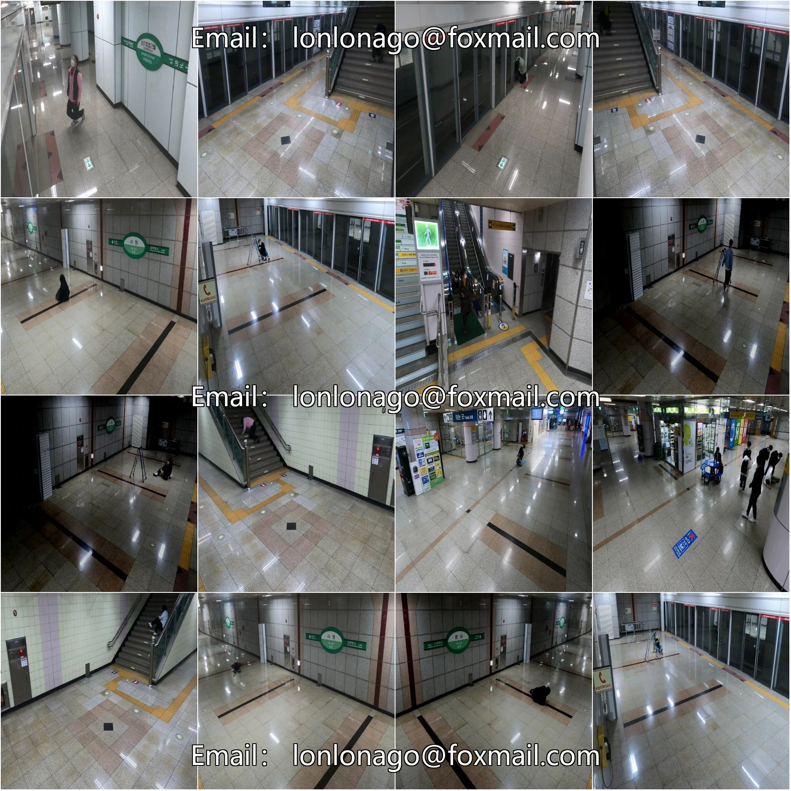
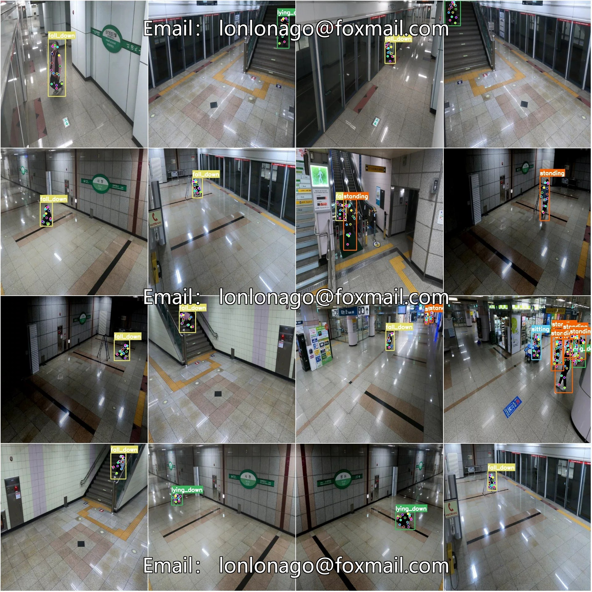

# COCO+YOL: Detection of Key Postures in Personnel Dangerous Behaviors within Subway Stations

## Body

Subway Station Critical Actions Key Point Estimation Detection Dataset COCO+YOLO format with 1005 images in 4 categories and 17 key points.
Tips: Due to the dataset's replicability, please confirm compliance before purchasing.
Dataset format: YOLO keypoint format (Note this is not the YOLO format for object detection or segmentation, but merely includes jpg images along with corresponding yolo format txt files.)
Number of images (number of jpg files): 1005
Number of annotations (number of txt files): 1005
Training set size: 904
Validation set size: 101
Test set size: 0
Number of annotated categories: 4

Label category names: ['fall_down', 'lying_down', 'sitting', 'standing']
Corresponding Chinese category name: [Fall, Lie Down, Sit, Stand]
Number of key points marked: 17

Key Point Category: ["nose", "left_eye", "right_eye", "left_ear", "right_ear", "left_shoulder", "right_shoulder", "left_elbow", "right_elbow", "left_wrist", "right_wrist", "left_hip", "right_hip", "left_knee", "right_knee", "left_ankle", "right_ankle"]
Number of boxes per category
Fall down = 571

Lying_down Frames = 412
Sitting Frames = 104
Standing Frames = 811
Total Frames = 1898
Image Resolution: 640x640
Important Note: The dataset has been pre-split into training, validation, and test sets. These can be directly used for training Yolov5-pose, Yolov8-pose, Yolov11-pose, or Yolov26-pose models.
Special Reminder: This dataset does not guarantee the accuracy of the trained models or weight files.

## Images

## Payment

Here is a pay link on Stripe ( https://buy.stripe.com/3cs8yP7sY87d0vu9AB ). Please contact me lonlonago@foxmail.com after funding $89, and I will send you a complete data files , thank you!

